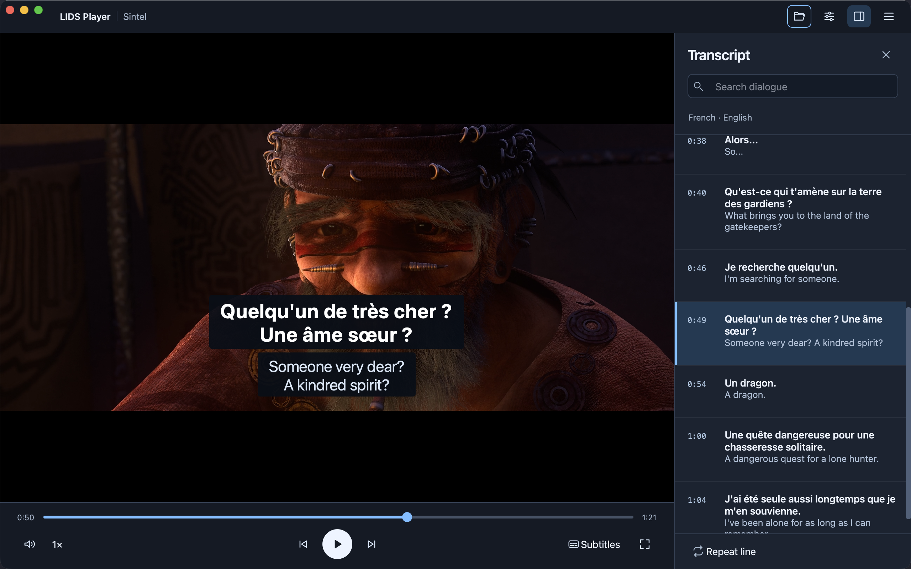
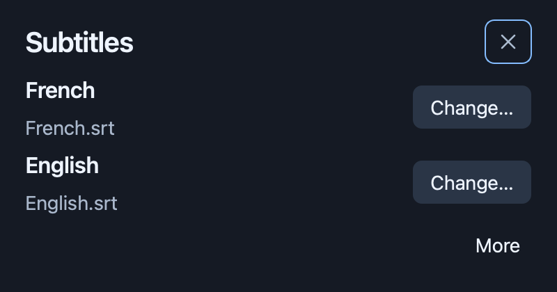

<p align="center">
  
</p>

# LIDS Player

Learn languages while watching. Play videos with two subtitle tracks, look up words, and follow the dialogue in a searchable transcript.

LIDS stands for **Language Immersion via Dual Subtitles**. Inspired by [umlx5h/LLPlayer](https://github.com/umlx5h/LLPlayer), this project brings that language-learning workflow to a native cross-platform player.



*Sintel* © copyright Blender Foundation · [durian.blender.org](https://durian.blender.org/) · [CC BY 3.0](https://creativecommons.org/licenses/by/3.0/).

## Download

Get the early preview from [GitHub Releases](https://github.com/ArsalanDotMe/LIDS-Player/releases).

| Platform | How to run |
| --- | --- |
| Windows x64 | Extract the Windows ZIP and open `LIDS Player.exe`. Keep the extracted folder together. |
| macOS Apple Silicon | Open the DMG and drag `LIDS Player.app` to Applications. A ZIP is also available. The preview is not notarized; you may need to allow it in System Settings → Privacy & Security. |
| Linux | Follow the [build and run from source guide](docs/building.md#linux-build-and-run-from-source). |

This is an early preview. Expect bugs and changes to settings between releases. Speech models download separately when first used. Translation providers may require an account or API key.

## Watch and learn

- **Two subtitle tracks:** load text or image subtitles, choose embedded tracks, and adjust each track’s timing and appearance.
- **Searchable dialogue:** click a timestamp to seek, look up a word, repeat a line, or pause at the end of a subtitle.
- **Speech subtitles:** generate subtitles as you watch with faster-whisper or whisper.cpp.
- **Translation:** use Google, DeepL, Azure, Ollama, LM Studio, or an OpenAI-compatible service.
- **Image subtitle lookup:** turn bitmap subtitles into text with OCR.
- **Local and online media:** open a file, drop it into the player, or play a supported online URL.
- **Save your subtitles:** export text, speech, OCR, and translated tracks as SRT.

## Getting started

1. Choose the language you speak and the language you’re learning on first launch.
2. Open a video or drop one into the window.
3. Open **Subtitles** to choose, load, find, generate, or translate each track. Shift-drop a subtitle file to load the secondary track.
4. Click a word to look it up, or use the transcript to search and jump through the dialogue.

<p align="center">
  
</p>

Press **F1** for shortcuts. See the [usage and service setup guide](docs/usage.md) for translation providers, speech models, OCR, and subtitle controls.

## Build and contribute

See [building from source](docs/building.md) for Linux, macOS, and Windows setup, native packaging, and playback checks. Development uses Python 3.12 and [uv](https://docs.astral.sh/uv/).

```sh
uv sync --python 3.12.13 --extra asr --extra dev --locked
uv run --no-sync llplayer
```

Install FFmpeg first for speech extraction and image subtitles. Read [CONTRIBUTING.md](CONTRIBUTING.md) before contributing.

## Credits and license

Thanks to [umlx5h/LLPlayer](https://github.com/umlx5h/LLPlayer) for the inspiration. The original project has its own code, assets, identity, and license.

The current first-party code and authored assets use the [MIT license](LICENSE). Bundled dependencies retain their own licenses, including LGPL components. See [third-party notices](THIRD_PARTY_NOTICES.md) for attribution, source, and redistribution details.
